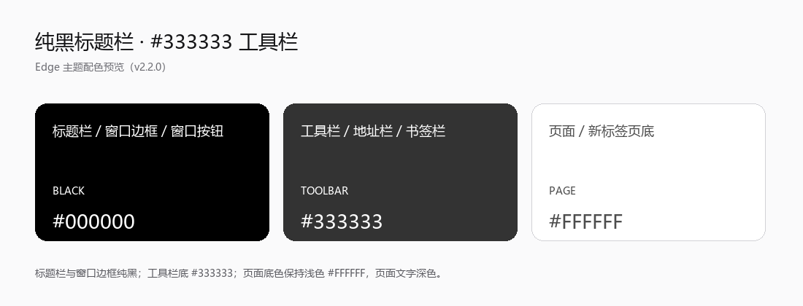

# Grey Black White

A minimal Microsoft Edge theme with a **pure black title bar and window frame** and a **#333333 toolbar**.



## Features

- Pure black (`#000000`) title bar, window frame, and window controls.
- `#333333` toolbar, address bar, and bookmarks bar.
- White page surface with dark, readable text.
- Theme-only: no scripts, no content scripts, no permissions, no data collection.

## Colors

| Area | Color |
| --- | --- |
| Title bar / window frame | `#000000` |
| Window controls | `#000000` |
| Toolbar / address bar / bookmarks bar | `#333333` |
| Toolbar text and icons | `#FFFFFF` |
| Page surface | `#FFFFFF` |
| Page text | `#1A1A1A` |

## Download

- GitHub release: https://github.com/DYouAn/grey-black-white/releases/latest
- Repository: https://github.com/DYouAn/grey-black-white

## Install (developer / unpacked)

1. Download `dist/Grey-Black-White-v2.2.0.zip` (or use the `theme/` folder directly).
2. Unzip it.
3. Open `edge://extensions/` in Microsoft Edge.
4. Enable **Developer mode**.
5. Click **Load unpacked** and select the folder containing `manifest.json`.
6. If needed, open **Settings → Appearance → Theme** and choose **Grey Black White**.

## Privacy

This theme only supplies static colours to Edge. It contains no scripts, makes no network requests, requests no permissions, and does not collect or share data.

See [privacy-policy.md](privacy-policy.md) or the hosted HTML version:

https://dyouan.github.io/grey-black-white/privacy-policy.html

## Repository layout

```
theme/                 Manifest + icons (load unpacked)
docs/                  Preview images and store screenshots
dist/                  Store-ready package for GitHub Releases
store/                 Edge Add-ons listing copy and publishing guide
privacy-policy.*       Policy text for the store / GitHub Pages
```

## Publishing to the Edge Add-ons store

The package in `dist/Grey-Black-White-v2.2.0.zip` has `manifest.json` at its root and is ready for Partner Center upload. See [store/publishing-guide-zh.md](store/publishing-guide-zh.md) and [store/listing.md](store/listing.md).
